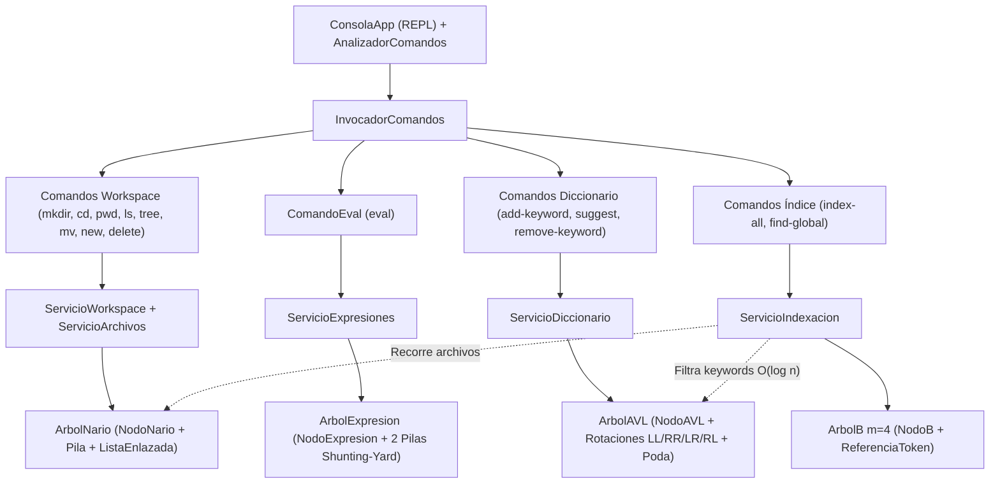

# Guía Arquitectónica y Mapa del Proyecto — Komorebi Mini IDE

---

## 1. Resumen del Proyecto (Overview)

- **Propósito Principal:** **Komorebi Mini IDE** es un entorno de desarrollo interactivo para terminal (CLI REPL) diseñado para gestionar espacios de trabajo jerárquicos de archivos de código en memoria con respaldo automático en disco, evaluar expresiones aritméticas exactas mediante Árboles de Expresiones, ofrecer diccionario y autocompletado por prefijo sobre Árboles AVL, indexar globalmente identificadores sobre un Árbol B de orden $m=4$, verificar balanceo sintáctico de delimitadores, administrar historial de cambios (*Undo/Redo*), ordenar diagnósticos con algoritmos clásicos y realizar análisis de complejidad algorítmica ($Big\ O$) asistido por IA (Google Gemini con modo *Offline Fallback*).
- **Tecnología / Stack Principal:** **Python 3.10+** utilizando exclusivamente su biblioteca estándar (`fractions`, `math`, `shlex`, `json`, `urllib`, `datetime`, `uuid`, `unittest`, `abc`), sin dependencias externas ni estructuras o métodos nativos prohibidos (`list.sort()`, `sorted()`, `collections.deque`, `eval()`, `ast`).
- **Paradigma y Estilo Arquitectónico:**
  - **Programación Orientada a Objetos (POO)** con encapsulamiento estricto (atributos privados `_atributo` y acceso controlado vía `@property`) y la regla estricta de **una sola clase por archivo**.
  - **Arquitectura en Capas Desacoplada (*Bottom-Up*):** separación neta entre Estructuras de Datos y Algoritmos (`src/estructuras`), Excepciones de Dominio (`src/excepciones`), Entidades del Núcleo (`src/nucleo`), Servicios de Negocio (`src/servicios`), Despacho de Comandos (`src/comandos`) e Interfaz de Consola (`src/cli`).

---

## 2. Árbol de Directorios y Archivos

```text
Komorebi/
├── main.py                                  # Punto de entrada y ensamblador de dependencias (Bootstrap / DI)
├── config.json                              # Archivo de configuración externa (rutas, IA, timeouts)
├── README.md                                # Documentación general, tabla Big-O y catálogo de comandos
├── docs/                                    # Documentación técnica, arquitectónica y de defensa académica
│   ├── ESTRUCTURA.md                        # Mapa arquitectónico integral del repositorio
│   ├── guia_defensa_fase2.md                # Guía de defensa académica de las 4 estructuras arbóreas
│   └── commits.md                           # Estándar de mensajes de commits del proyecto
├── scripts/                                 # Scripts demostrativos independientes
│   └── demo_avl_vs_bst.py                   # Comparación empírica de altura entre BST normal y Árbol AVL
├── src/                                     # Código fuente principal del sistema
│   ├── cli/                                 # Capa de Interfaz de Línea de Comandos (Presentación / REPL)
│   │   ├── analizador_comandos.py           # Parser léxico de entradas de usuario con soporte de comillas
│   │   └── consola_app.py                   # Bucle interactivo REPL, prompt dinámico [/ruta] y captura de errores
│   ├── comandos/                            # Capa de Aplicación (Implementación del Patrón Command)
│   │   ├── comando_base.py                  # Clase base abstracta (Interfaz Command)
│   │   ├── invocador_comandos.py            # Invoker: registro, búsqueda, ordenación propia y despacho
│   │   ├── comando_new.py                   # Crea un archivo en el directorio actual y guarda respaldo
│   │   ├── comando_list.py                  # Lista archivos abiertos con su ruta en el Workspace
│   │   ├── comando_switch.py                # Cambia el archivo activo por ID, nombre o ruta
│   │   ├── comando_delete.py                # Elimina archivos/carpetas de N-ario, Lista, B-Tree y disco
│   │   ├── comando_edit.py                  # Añade líneas al archivo activo registrando historial Undo
│   │   ├── comando_show.py                  # Muestra el contenido numerado del archivo activo
│   │   ├── comando_undo.py                  # Revierte la última edición mediante la pila Undo
│   │   ├── comando_redo.py                  # Restaura una edición revertida mediante la pila Redo
│   │   ├── comando_check.py                 # Ejecuta el verificador sintáctico de delimitadores
│   │   ├── comando_sort.py                  # Ordena diagnósticos usando MergeSort o ShellSort
│   │   ├── comando_queue_status.py          # Muestra el estado de la cola FIFO de peticiones IA
│   │   ├── comando_analyze.py               # Encola y procesa análisis de código con el cliente IA
│   │   ├── comando_config.py                # Visualiza o recarga la configuración desde JSON
│   │   ├── comando_mkdir.py                 # Crea directorios en el Árbol N-ario del Workspace
│   │   ├── comando_cd.py                    # Cambia el directorio actual (soporta /, ., .. y rutas relativas)
│   │   ├── comando_pwd.py                   # Muestra la ruta absoluta del directorio actual
│   │   ├── comando_ls.py                    # Lista el contenido del directorio actual o de una ruta
│   │   ├── comando_tree.py                  # Dibuja en ASCII el Árbol N-ario del Workspace (preorden iterativo)
│   │   ├── comando_mv.py                    # Mueve o renombra archivos/carpetas previniendo ciclos
│   │   ├── comando_eval.py                  # Evalúa expresiones aritméticas con Árbol de Expresiones
│   │   ├── comando_add_keyword.py           # Agrega una palabra clave al diccionario Árbol AVL
│   │   ├── comando_suggest.py               # Sugiere palabras por prefijo con poda en el Árbol AVL
│   │   ├── comando_remove_keyword.py        # Elimina una palabra clave del Árbol AVL con rebalanceo
│   │   ├── comando_index_all.py             # Indexa todos los identificadores del Workspace en el Árbol B
│   │   ├── comando_find_global.py           # Busca un identificador en el índice global Árbol B
│   │   ├── comando_clear.py                 # Limpia la pantalla de la terminal interactiva (clear / cls)
│   │   ├── comando_help.py                  # Genera dinámicamente la tabla de ayuda de los comandos
│   │   └── comando_exit.py                  # Señaliza el cierre limpio del bucle REPL
│   ├── servicios/                           # Capa de Dominio / Lógica de Negocio (Receptores)
│   │   ├── servicio_archivos.py             # Coordina ListaEnlazada, ArbolNario, ArbolB y respaldos en disco
│   │   ├── servicio_workspace.py            # Orquesta operaciones jerárquicas del Workspace sobre ArbolNario
│   │   ├── servicio_navegacion.py           # cd/ls/pwd híbridos: SO real (por defecto) y Workspace virtual (prefijo ws:)
│   │   ├── servicio_expresiones.py          # Evalúa expresiones directas o líneas aritméticas del archivo activo
│   │   ├── servicio_diccionario.py          # Gestiona el diccionario de keywords de Python sobre ArbolAVL
│   │   ├── servicio_indexacion.py           # Tokenizador léxico propio e indexación global sobre ArbolB
│   │   ├── servicio_sintaxis.py             # Analizador léxico de balanceo de (), {}, [] con Pila
│   │   ├── servicio_historial.py            # Motor Undo/Redo basado en doble Pila LIFO por archivo
│   │   ├── servicio_diagnosticos.py         # Ordenamiento de alertas con MergeSort y ShellSort
│   │   ├── servicio_cola_ia.py              # Gestión del buffer FIFO de solicitudes hacia la IA
│   │   ├── servicio_cliente_ia.py           # Cliente HTTP Gemini API + motor heurístico Offline Fallback
│   │   ├── servicio_configuracion.py        # Lectura, validación y carga de config.json
│   │   └── servicio_logs.py                 # Escritura de trazas y errores en logs/errores.log
│   ├── nucleo/                              # Capa de Entidades de Dominio y Estado de Sesión
│   │   ├── archivo_codigo.py                # Entidad de archivo en memoria con id_archivo único inmutable
│   │   ├── referencia_token.py              # Entidad inmutable (id_archivo, linea) para hojas del Árbol B
│   │   ├── diagnostico.py                   # Entidad de error/alerta sintáctica (línea, columna, severidad)
│   │   ├── peticion_ia.py                   # Entidad de solicitud de análisis de IA y su ciclo de estados
│   │   ├── configuracion_app.py             # Objeto de valor con los parámetros de configuración
│   │   └── contexto_app.py                  # Contenedor del estado global (Lista, Cola, N-ario, AVL, B-Tree)
│   ├── excepciones/                         # Jerarquía de Excepciones de Dominio (1 clase por archivo)
│   │   ├── error_synthetix.py               # Excepción base del dominio (con alias ErrorKomorebi)
│   │   ├── ruta_invalida_error.py           # Error de resolución de rutas o ambigüedad de archivos
│   │   ├── nombre_duplicado_error.py        # Error de colisión de nombres en un mismo directorio
│   │   ├── movimiento_invalido_error.py     # Error al mover la raíz o mover carpeta dentro de su subárbol
│   │   ├── expresion_invalida_error.py      # Error léxico o sintáctico en expresiones aritméticas
│   │   ├── division_por_cero_error.py       # Error matemático de división entre cero en evaluación
│   │   └── palabra_duplicada_error.py       # Error al insertar una palabra repetida en el Árbol AVL
│   └── estructuras/                         # Capa Base: Estructuras de Datos y Algoritmos desde cero
│       ├── nodo_lista.py                    # Nodo doblemente enlazado (anterior, siguiente)
│       ├── lista_enlazada.py                # Lista doblemente enlazada genérica O(1) en extremos
│       ├── nodo_pila.py                     # Nodo simple para estructura LIFO
│       ├── pila.py                          # Pila LIFO dinámica para sintaxis, Undo/Redo, tree y Shunting-Yard
│       ├── nodo_cola.py                     # Nodo simple para estructura FIFO
│       ├── cola_fifo.py                     # Cola FIFO dinámica para el buffer de peticiones IA
│       ├── nodo_nario.py                    # Nodo del Árbol N-ario (CARPETA con ListaEnlazada de hijos o ARCHIVO)
│       ├── arbol_nario.py                   # Árbol N-ario del Workspace con resolución de rutas y preorden iterativo
│       ├── nodo_expresion.py                # Nodo binario para operadores y operandos aritméticos
│       ├── arbol_expresion.py               # Árbol Binario de Expresiones (Shunting-Yard, Fraction, RPN)
│       ├── nodo_avl.py                      # Nodo del Árbol AVL con palabra, descripción y altura cacheada
│       ├── arbol_avl.py                     # Árbol AVL con rotaciones LL/RR/LR/RL y autocompletado con poda
│       ├── nodo_b.py                        # Página multicamino del Árbol B (claves, valores, hijos, es_hoja)
│       ├── arbol_b.py                       # Árbol B de orden m=4 (inserción bottom-up, split, préstamo y fusión)
│       ├── mergesort.py                     # Algoritmo recursivo Divide y Vencerás O(n log n)
│       └── shellsort.py                     # Algoritmo in-place con secuencia de intervalos de Knuth
└── test/                                    # Suite de pruebas unitarias e integración (133 tests)
    ├── test_lista_enlazada.py               # Pruebas de ListaEnlazada
    ├── test_pila.py                         # Pruebas de Pila LIFO
    ├── test_cola_fifo.py                    # Pruebas de ColaFIFO
    ├── test_mergesort.py                    # Pruebas de MergeSort
    ├── test_shellsort.py                    # Pruebas de ShellSort
    ├── test_archivo_codigo.py               # Pruebas de ArchivoCodigo e id_archivo inmutable
    ├── test_diagnostico.py                  # Pruebas de Diagnostico
    ├── test_peticion_ia.py                  # Pruebas de PeticionIA
    ├── test_configuracion_app.py            # Pruebas de ConfiguracionApp
    ├── test_contexto_app.py                 # Pruebas de ContextoApp
    ├── test_fase0_base.py                   # Pruebas de jerarquía ErrorSynthetix y ReferenciaToken
    ├── test_servicio_archivos.py            # Pruebas de ServicioArchivos y respaldos
    ├── test_servicio_sintaxis.py            # Pruebas de validación de delimitadores
    ├── test_servicio_historial.py           # Pruebas de Undo / Redo
    ├── test_servicio_diagnosticos.py        # Pruebas de ordenamiento de diagnósticos
    ├── test_servicio_cola_ia.py             # Pruebas de encolado FIFO de IA
    ├── test_servicio_cliente_ia.py          # Pruebas de cliente IA y modo Offline Fallback
    ├── test_servicio_configuracion.py       # Pruebas de carga JSON
    ├── test_servicio_logs.py                # Pruebas de escritura y lectura de logs
    ├── test_patron_comandos.py              # Pruebas de integración de comandos base
    ├── test_cli.py                          # Pruebas de AnalizadorComandos y ConsolaApp
    ├── test_arbol_nario_workspace.py        # Pruebas de ArbolNario, ServicioWorkspace y comandos de directorio
    ├── test_arbol_expresiones.py            # Pruebas de ArbolExpresion, Shunting-Yard y ComandoEval
    ├── test_arbol_avl.py                    # Pruebas de ArbolAVL, rotaciones, poda y ServicioDiccionario
    ├── test_arbol_b.py                      # Pruebas de ArbolB (m=4), splits, fusiones y ServicioIndexacion
    └── test_integracion_fase2.py            # Prueba E2E por REPL y auditoría automática de reglas de código
```

---

## 3. Arquitectura y Patrones de Diseño

### Patrones de Diseño Implementados

1. **Command Pattern (Patrón Comando):**
   - **Propósito:** Desacoplar el bucle REPL (`ConsolaApp`) de los servicios de negocio y estructuras de datos subyacentes, eliminando cualquier menú numérico o bloques condicionales monolíticos.
   - **Participantes:**
     - **Command (`ComandoBase`):** Clase abstracta que exige implementar `ejecutar(argumentos: List[str]) -> bool`.
     - **Concrete Commands (27 clases en `src/comandos/`):** Delegan toda la lógica a su servicio receptor correspondiente.
     - **Invoker (`InvocadorComandos`):** Almacena el catálogo de comandos, los ordena con inserción propia y captura polimórficamente cualquier `ErrorSynthetix`.
     - **Receivers (`src/servicios/`):** Ejecutan las operaciones sobre el estado y las estructuras de datos.
     - **Client (`main.py -> bootstrap()`):** Instancia e inyecta todas las dependencias.

2. **Shared State / Context Object (`ContextoApp`):**
   - Mantiene sincronizadas las estructuras en vivo de la sesión:
     - `archivos_abiertos` (`ListaEnlazada` de `ArchivoCodigo`)
     - `workspace` (`ArbolNario` de carpetas y archivos, compartiendo exactamente las mismas referencias de `ArchivoCodigo`)
     - `directorio_actual` (`NodoNario` activo en el Workspace)
     - `diccionario` (`ArbolAVL` con las palabras reservadas de Python y keywords del usuario)
     - `indice_global` (`ArbolB` de orden $m=4$ que mapea cada identificador a su lista de `ReferenciaToken`)

### Diagrama de Interacción entre Capas y Estructuras Arbóreas



---

## 4. Desglose de Clases, Módulos y Funciones Clave

| Capa | Archivo | Clase / Símbolo | Responsabilidad Principal |
| :--- | :--- | :--- | :--- |
| **Bootstrap** | `main.py` | `bootstrap()`, `main()` | Ensambla configuración, contexto, los 12 servicios y los 27 comandos CLI. |
| **CLI** | `src/cli/analizador_comandos.py` | `AnalizadorComandos` | Tokeniza la línea ingresada respetando comillas mediante `shlex`. |
| **CLI** | `src/cli/consola_app.py` | `ConsolaApp` | Gestiona el ciclo REPL, el prompt dinámico `Komorebi [/ruta]> ` y captura `ErrorSynthetix`. |
| **Excepciones** | `src/excepciones/*.py` | `ErrorSynthetix` y 6 subclases | `RutaInvalidaError`, `NombreDuplicadoError`, `MovimientoInvalidoError`, `ExpresionInvalidaError`, `DivisionPorCeroError`, `PalabraDuplicadaError`. |
| **Núcleo** | `src/nucleo/archivo_codigo.py` | `ArchivoCodigo` | Modelo de archivo con `_id_archivo` inmutable (`file-<uuid8>`), nombre y contenido. |
| **Núcleo** | `src/nucleo/referencia_token.py` | `ReferenciaToken` | Objeto de valor inmutable (`__slots__`) con `(id_archivo, linea)` para el Árbol B. |
| **Núcleo** | `src/nucleo/contexto_app.py` | `ContextoApp` | Estado global unificado de la sesión (Lista, Cola, N-ario, AVL y B-Tree). |
| **Estructuras** | `src/estructuras/arbol_nario.py` | `ArbolNario` / `NodoNario` | Jerarquía de carpetas y archivos con rutas relativas/absolutas, detección de ciclos y `tree` iterativo con `Pila`. |
| **Estructuras** | `src/estructuras/arbol_expresion.py` | `ArbolExpresion` / `NodoExpresion` | Tokenizador propio, Shunting-Yard con 2 instancias de `Pila`, evaluación exacta con `Fraction` y recorridos. |
| **Estructuras** | `src/estructuras/arbol_avl.py` | `ArbolAVL` / `NodoAVL` | BST autobalanceado con rotaciones `LL`, `RR`, `LR`, `RL`, eliminación recursiva y autocompletado con poda. |
| **Estructuras** | `src/estructuras/arbol_b.py` | `ArbolB` / `NodoB` | Árbol B multicamino de orden $m=4$ con inserción *bottom-up*, *split* por mediana, préstamo, fusión y validación. |
| **Servicios** | `src/servicios/servicio_workspace.py` | `ServicioWorkspace` | Sincroniza el `ArbolNario` con `ServicioArchivos` y el directorio físico `respaldos/`. |
| **Servicios** | `src/servicios/servicio_expresiones.py` | `ServicioExpresiones` | Evalúa expresiones aritméticas individuales o por lote desde el archivo activo. |
| **Servicios** | `src/servicios/servicio_diccionario.py` | `ServicioDiccionario` | Precarga las 35 keywords de Python en el `ArbolAVL` y gestiona consultas y sugerencias con poda. |
| **Servicios** | `src/servicios/servicio_indexacion.py` | `ServicioIndexacion` | Extrae identificadores con tokenizador propio, descarta keywords vía `ArbolAVL` e indexa en `ArbolB`. |

---

## 5. Flujo de Ejecución (Data Flow)

### Caso A: Creación, Movimiento e Indexación Global (`mkdir`, `new`, `index-all`, `mv`, `find-global`)
1. **Creación jerárquica:** Al ejecutar `mkdir src`, `cd ws:/src` y `new app.py`, `ServicioWorkspace` y `ServicioArchivos` crean el nodo carpeta `/src` y el nodo archivo `/src/app.py` en el `ArbolNario`, insertan la **misma instancia** `ArchivoCodigo` (con `id_archivo` inmutable `file-xxxxxxxx`) en `ContextoApp.archivos_abiertos` (`ListaEnlazada`), y escriben `respaldos/src/app.py`.
2. **Indexación en Árbol B (`index-all`):** `ServicioIndexacion.indexar_todo()` recorre el `ArbolNario` usando una `Pila` explícita, extrae cada identificador con su tokenizador carácter por carácter, consulta `ContextoApp.diccionario.contiene(token)` en el `ArbolAVL` en $\mathcal{O}(\log n)$ para descartar palabras reservadas (`def`, `return`, `if`, etc.), e inserta `ReferenciaToken(id_archivo, linea)` en el `ArbolB` de orden $m=4$.
3. **Movimiento sin invalidar referencias (`mv /src/app.py /core/app.py`):** `ArbolNario.mover()` verifica que no se forme un ciclo jerárquico, reasigna el puntero `padre` del `NodoNario` a `/core` y mueve el archivo físico en `respaldos/core/app.py`. Como `ReferenciaToken` almacena el `id_archivo` inmutable y no la ruta textual, al ejecutar `find-global <token>` inmediatamente después, `ServicioIndexacion` resuelve `id_archivo` contra el `ArbolNario` y muestra `/core/app.py`.
